<p align="center"></p>

# ThixInstall

**Apps installieren, aktualisieren und verwalten – für Windows und macOS.** Eine Alternative zu Ninite: auf der
Startseite deiner **ThixInstall.Cloud** klickst du dir Apps und Skripte zusammen – auch ohne Konto – und lädst sie als
**ein Programm** herunter, das alles still installiert. Mit Konto installiert das Paket auf Wunsch **ThixInstall selbst**
mit: dann zeigt das Gerät Updates, installiert aus dem Katalog und führt – mit **Sync** – Aufträge aus, die du aus der Cloud
schickst. Eine einfache Version von Intune/Entra.

- **Plakative Auswahl**: Apps als Kacheln nach Kategorien, Skripte („Makros“) daneben, getrennt nach Windows und macOS.
- **Ein Download, alles installiert**: **eine** EXE, die Konfiguration (Apps, Skripte, ThixInstall selbst, Profil) steckt
  darin; sie installiert nacheinander, überspringt Aktuelles, aktualisiert Älteres.
- **winget, Microsoft Store, Chocolatey und Homebrew im Unterbau** – die Cloud löst die Installer auf (winget-Manifeste, Homebrew-API) und
  **cached die Downloads**: jedes Gerät lädt aus deiner Cloud, geprüft per SHA-256. Dazu direkte Downloads und **eigene Installer**
  (MSI, EXE, MSIX, DMG, PKG, ZIP), die du in die Cloud hochlädst – für Firmensoftware, die es in keinem Repository gibt.
- **Thix-Apps** (ThixFred, ThixClip, ThixNote) direkt aus ihrem Release-Kanal: wer eine auf der Startseite ankreuzt, sieht die
  Fragen ihres Setups – Desktop-Verknüpfung, Autostart, automatische Updates, Dateitypen, mit ihren Vorgaben – und das Gerät
  installiert sie still mit genau diesen Antworten (MatDesign SETUP-08).
- **App hinzufügen mit einem Klick**: Namen eingeben, die Cloud sucht in allen Quellen, schlägt je System den passenden Treffer vor und füllt
  Name, Herausgeber, Beschreibung, Homepage und Icon selbst aus.
- **ThixInstall auf dem Gerät** (Tray / Menüleiste): Katalog, Updates (einzeln, alle, oder automatisch täglich), Skripte,
  Aufträge mit Ausgabe. Unter Windows erledigt ein **Dienst** die Arbeit – still, ohne UAC-Abfragen, für alle Benutzer.
- **Sync**: das Gerät meldet seine installierten Apps und führt Aktionen aus der Cloud aus (installieren, aktualisieren,
  deinstallieren, Skript ausführen, alles aktualisieren).
- **Profile** bündeln Apps und Skripte für Geräte; mit dem **Registrierungsschlüssel** melden sich neue Geräte selbst an
  (Auto-Enrollment) und bekommen das Profil.
- **Autostart**, **Setup** (Windows) bzw. **App-Bundle + DMG** (macOS), **OTA-Updates** mit optionalem **Full-Auto-Update**.

| Katalog (hell) | Katalog (dunkel) |
|---|---|
| 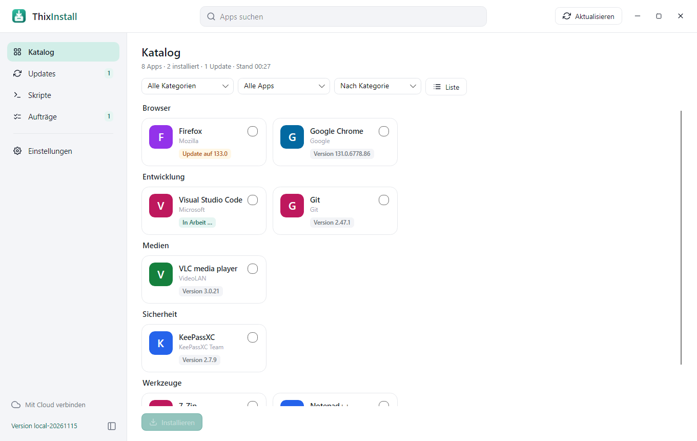 | 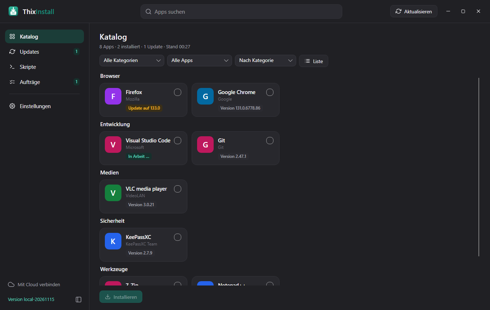 |

| Updates | Aufträge | Einstellungen › Cloud |
|---|---|---|
| 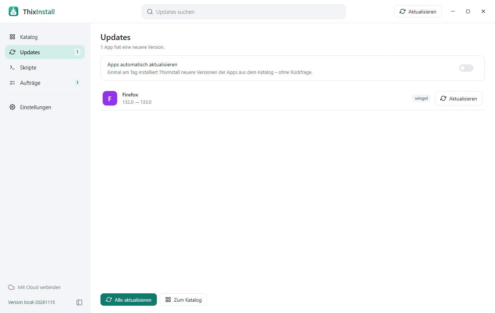 | 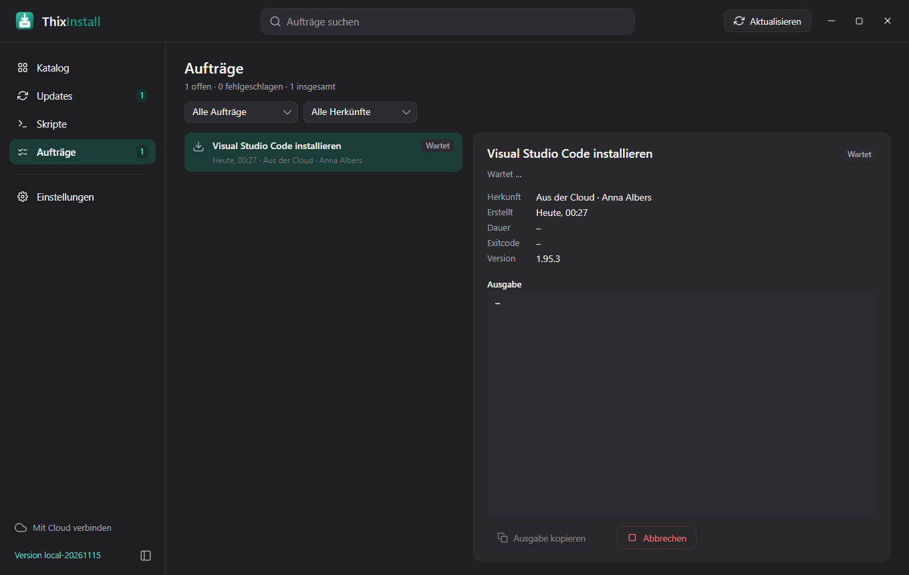 | 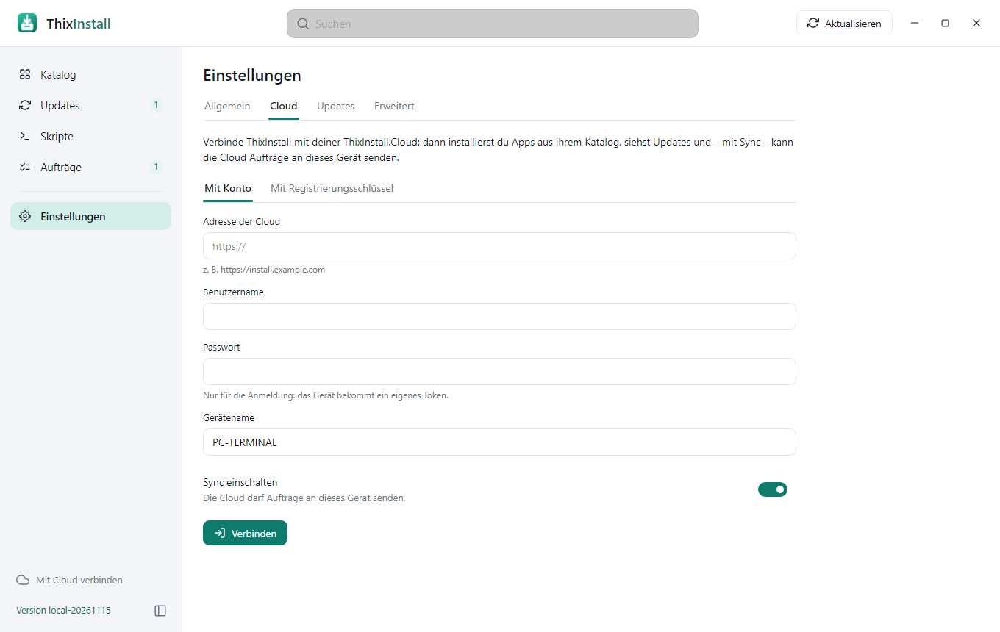 |

**ThixInstall.Cloud**

| Startseite: Apps auswählen | Paket herunterladen |
|---|---|
| 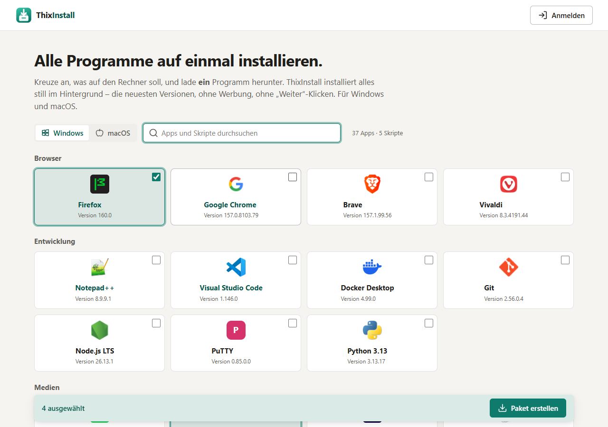 | 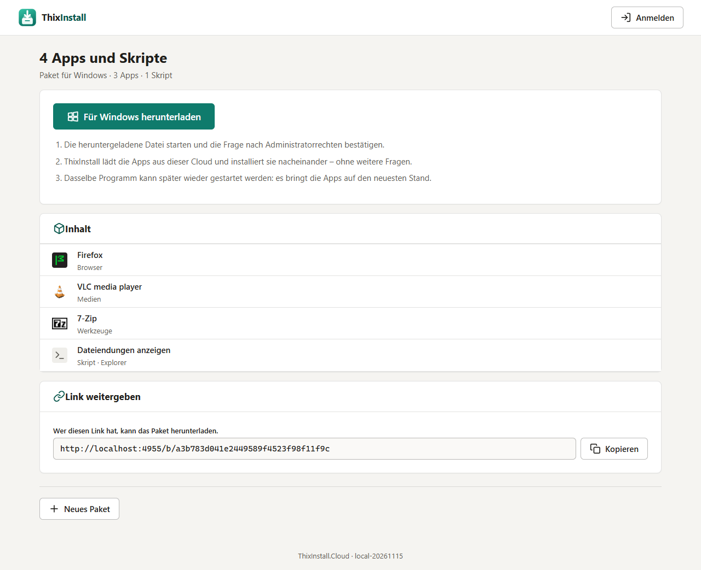 |

| Geräte | Software eines Geräts | Profil: Registrierung |
|---|---|---|
| 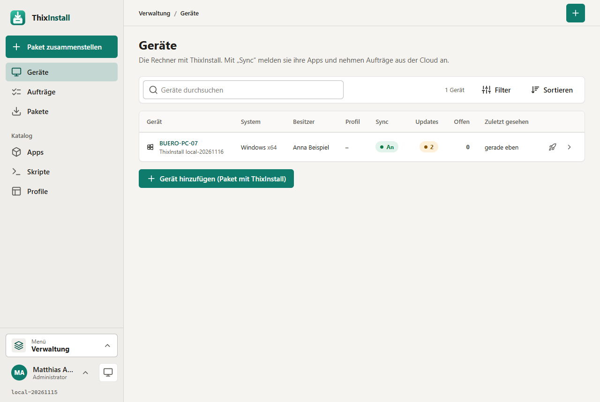 | 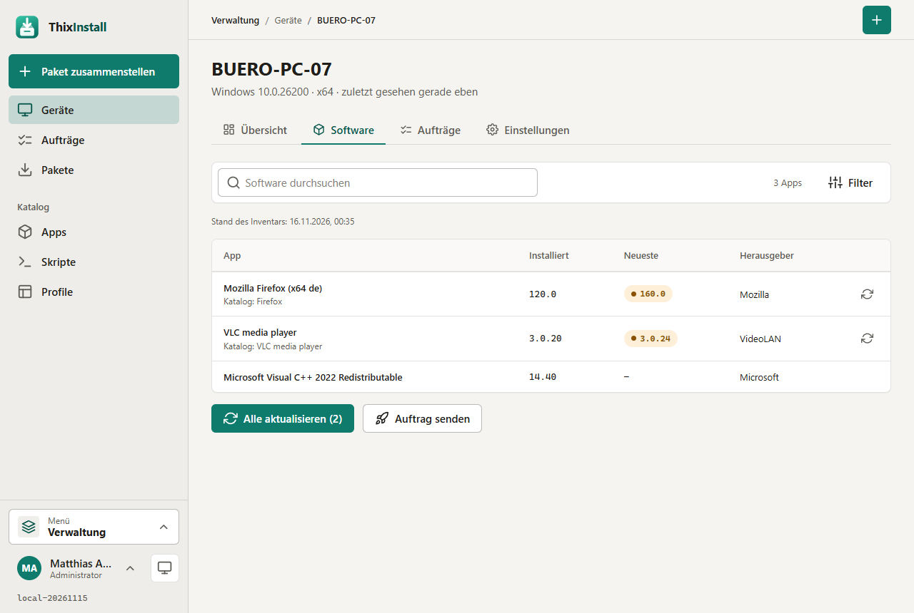 | 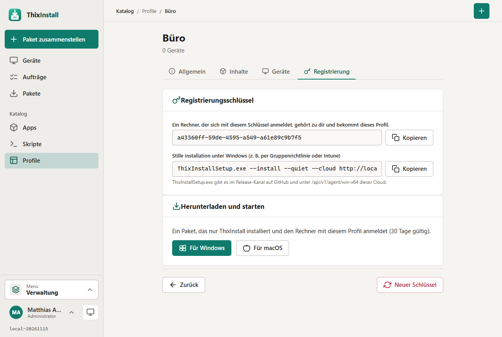 |

| App im Katalog: Versionen | Auftrag senden | Telefon |
|---|---|---|
| 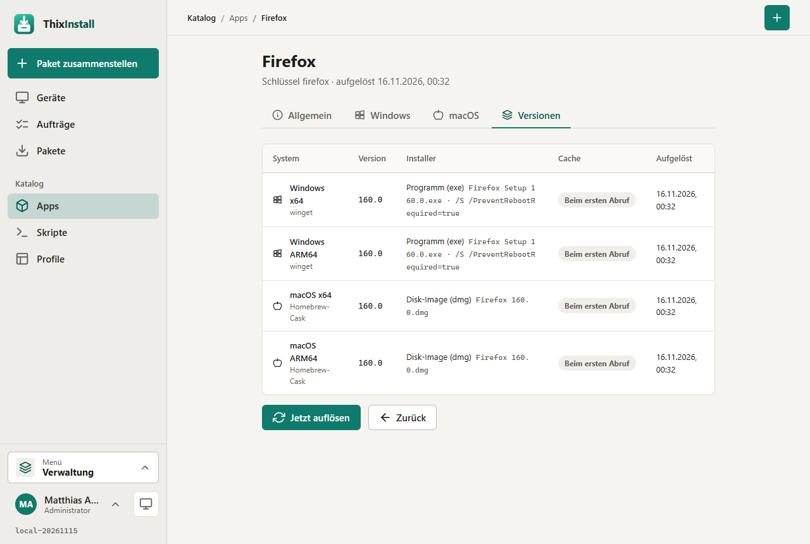 | 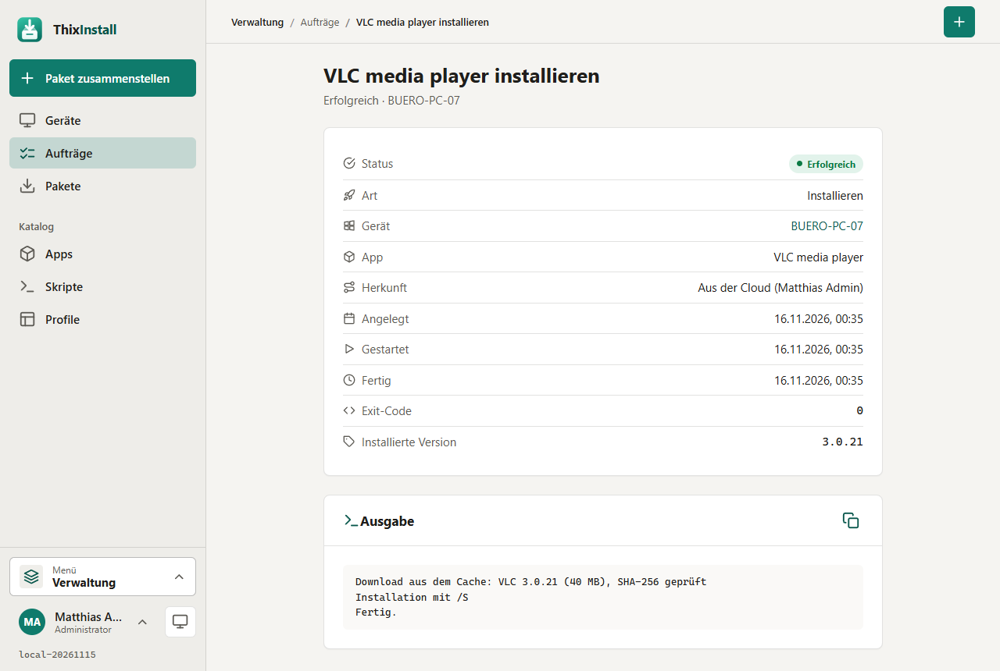 | 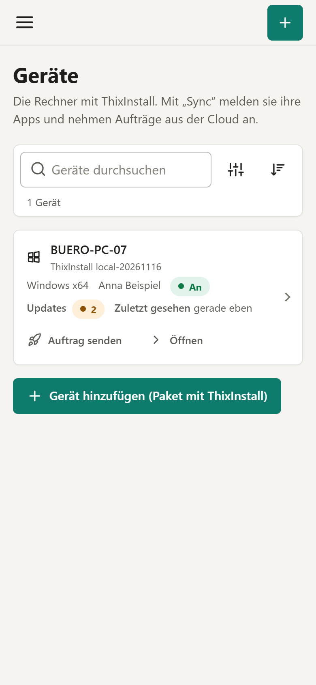 |

| App hinzufügen: alle Quellen durchsuchen | Eigene Datei als Quelle | Telefon |
|---|---|---|
| 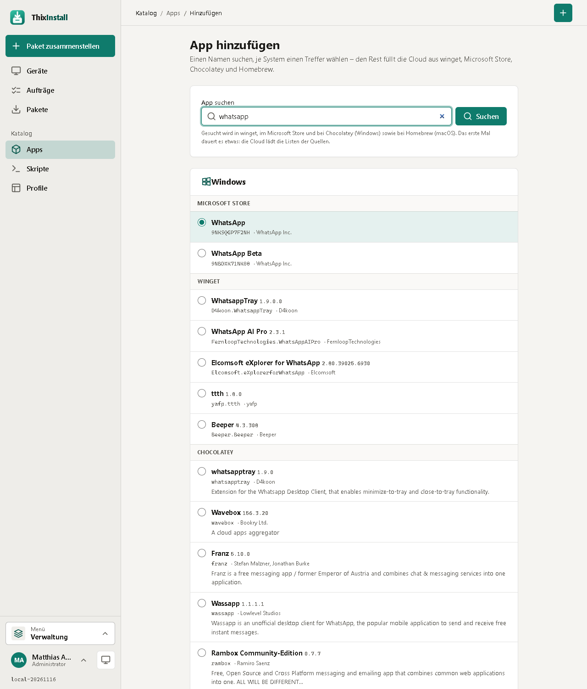 | 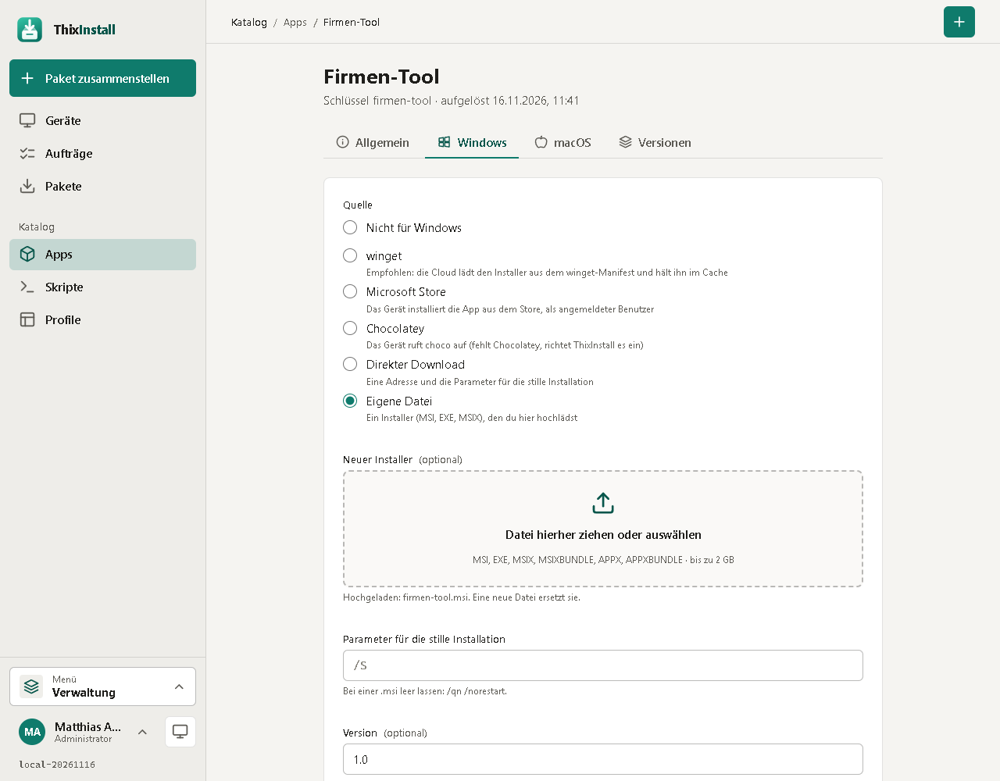 | 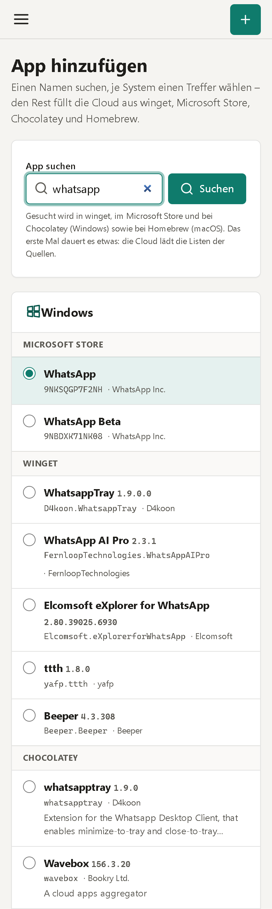 |

## So funktioniert es

```
Startseite der Cloud ──► Auswahl ──► eine EXE (Konfiguration eingepackt) ──► installiert alles still
                                           │
                                           └─ mit Konto: ThixInstall wird mitinstalliert und verbunden
ThixInstall.Cloud ◄──── Inventar, Ergebnisse ────── Gerät (Dienst / App)
        │──────────── Aufträge (Sync), Profile ────►
        └─ löst Pakete auf (winget, Store, Chocolatey, Homebrew) und liefert die Installer aus dem Cache
```

Mehr: [docs/ARCHITECTURE.md](docs/ARCHITECTURE.md) (Begriffe, Betriebsarten, Datenmodell) und [docs/CLOUD.md](docs/CLOUD.md) (Server).

## Installation

**Cloud** – auf einem Server mit Docker:

```bash
docker compose up -d
```

Dann `http://<server>:4955` öffnen: der Einrichtungsassistent legt den Administrator an, der Katalog ist mit beliebten
Apps vorbelegt. Für den Zugriff aus dem Internet gehört ein Reverse-Proxy mit HTTPS davor.

**Windows** – entweder ein Paket von der Startseite der Cloud laden, oder `ThixInstallSetup.exe` aus dem
[Release-Kanal](https://github.com/Real-TTX/ThixInstall/releases/tag/release-channel) starten. ThixInstall wird für den
ganzen Computer installiert (`%ProgramFiles%\ThixInstall`, Dienst „ThixInstall Agent“, Startmenü, Autostart); Windows fragt
dafür einmal nach Administratorrechten. Still und mit Auto-Enrollment:

```
ThixInstallSetup.exe --install --quiet --cloud https://install.example.com --enroll-key <Registrierungsschlüssel>
```

**Ohne Fenster** (ThixLauncher, Administratoren) – die Optionen des Setups als Argumente (MatDesign SETUP-05/08; was angeboten
wird, steht in `src/ThixInstall.Core/installer.json` und im Update-Manifest unter `installer`):

```
ThixInstallSetup.exe --quiet --desktop-shortcut=yes --autostart=no --automatic-updates=yes [--start] [--cloud <url> --enroll-key <schlüssel>]
ThixInstall.exe --configure --autostart=yes        # nur anwenden (macOS: nach dem Kopieren des Bundles)
"%ProgramFiles%\ThixInstall\ThixInstall.exe" --uninstall --quiet [--delete-data]
```

Nicht angegebene Optionen: bei der Erstinstallation der Standard, bei einem Update bleibt es, wie es ist. Ein falscher Wert
bricht mit Exit-Code 2 ab, ohne etwas zu installieren (Exit-Code 3: installiert, aber die Verbindung zur Cloud schlug fehl).
Die älteren Schalter `--install`, `--no-autostart`, `--desktop`, `--no-auto-update` gelten weiter; dazu `--log <datei>`.
Deinstallieren auch über „Installierte Apps“.

**macOS** – das Paket von der Startseite laden (Zip mit `ThixInstall.app` und dem Ticket daneben) und ThixInstall öffnen,
oder `ThixInstall-macOS-arm64.dmg` (Apple Silicon) bzw. `-x64.dmg` (Intel) aus dem Release-Kanal öffnen und ThixInstall in
„Programme“ ziehen. Apps aus Casks installiert ThixInstall ohne Homebrew (der Download kommt aus der Cloud);
Kommandozeilen-Werkzeuge (Formeln) brauchen Homebrew. Die App ist (noch) ad hoc signiert: beim ersten Start Rechtsklick › Öffnen.

## Versionen, Kanäle, Updates

| Branch | Version | Desktop-Kanal | Docker-Image |
|---|---|---|---|
| `main` | `0.1.<build>-<datum>` (z. B. `0.1.42-20261115`) | `release-channel` + Release `v<version>` | `ghcr.io/real-ttx/thixinstall:latest`, `:release`, `:<version>` |
| `dev` | `nightly-<build>-<datum>` | `nightly-channel` | `:nightly`, `:<version>` |
| sonst / lokal | `local-<datum>` | – (keine Updates) | – |

Jede installierte Version prüft beim Start und alle 6 Stunden ihren eigenen Kanal (abschaltbar); mit „Updates automatisch
installieren“ (Full-Auto-Update, bei neuen Installationen an) wird ohne Rückfrage aktualisiert. Danach startet die App wieder
(Windows: sobald der Dienst in der neuen Version läuft, macOS: sobald das Bundle ersetzt ist) – mit ihrem Fenster, wenn das Update
dort mit „Update installieren“ angestoßen wurde oder das Fenster offen war, sonst still im Tray bzw. in der Menüleiste. Die Cloud liefert in Paketen
die Desktop-App ihres eigenen Kanals aus (eine lokale Cloud den Release-Kanal, oder eine hochgeladene Datei).
Compose-Dateien: `docker-compose.yml` (Release), `docker-compose.dev.yml` (Nightly + pgAdmin),
`docker-compose.local.yml` (aus dem Quellcode gebaut, + pgAdmin, Postgres auf 4957).

## Für Administratoren

Richtlinien (Wert 1): Windows `HKLM\SOFTWARE\Policies\ThixInstall`, macOS Konfigurationsprofil `info.schmoldt.thixinstall`.

| Richtlinie | Wirkung |
|---|---|
| `LockConfiguration` | Einstellungen und Cloud-Verbindung nur lesbar |
| `DisableCloud` | keine Verbindung zu ThixInstall.Cloud |
| `DisableUpdates` | keine Updates von ThixInstall selbst |
| `DisableUserInstalls` | in der App installieren und entfernen nur Administratoren (die Cloud weiterhin) |
| `DisableScripts` | keine Skripte (weder aus der App noch aus der Cloud) |

Ein Gerät, das sich mit einem Registrierungsschlüssel oder einem Paket angemeldet hat, ist **verwaltet**: nur ein
Administrator kann es von der Cloud trennen oder Sync ausschalten.

## Entwicklung

```bash
dotnet build ThixInstall.slnx
dotnet test tests/ThixInstall.Tests                    # Desktop: Logik, Agent gegen Fake-Cloud, UI headless
dotnet test tests/ThixInstall.Cloud.Tests              # Cloud (mit THIXINSTALL_TEST_DB gegen PostgreSQL)
./scripts/redeploy.ps1                                 # Cloud lokal bauen und starten: http://localhost:4955
THIXINSTALL_DATA_DIR=/tmp/ti dotnet run --project src/ThixInstall   # Desktop mit eigenen Daten (Agent im Programm)
```

Mehr in [CLAUDE.md](CLAUDE.md).
