# ThixInstall.Cloud

Der Server von ThixInstall: Katalog (Apps und Skripte), Startseite zum Zusammenstellen von Paketen, Geräte mit Inventar und Aufträgen,
Profile mit Auto-Enrollment, Download-Cache und die API für die Desktop-App. ASP.NET Core (.NET 10), Razor Pages mit **MatUi** (MatDesign,
Kopie unter `wwwroot/matui`, Version in der ersten Zeile von `matui.css`), EF Core + PostgreSQL, Docker, **Port 4955**. PWA (Manifest,
Service Worker, Offline-Seite). Oberfläche Deutsch, Code Englisch. Die Architektur des Ganzen: [ARCHITECTURE.md](ARCHITECTURE.md).

| Startseite | Paket | Gerät |
|---|---|---|
| 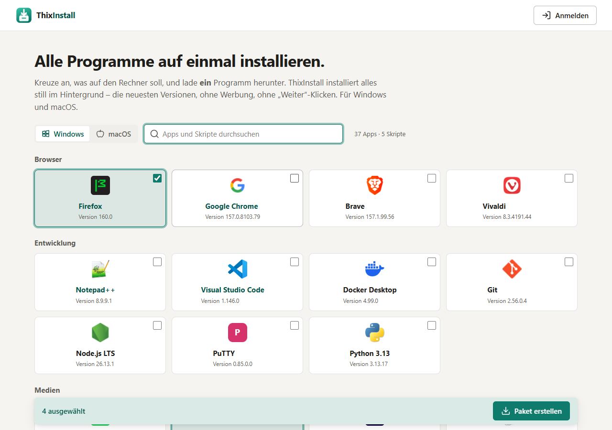 | 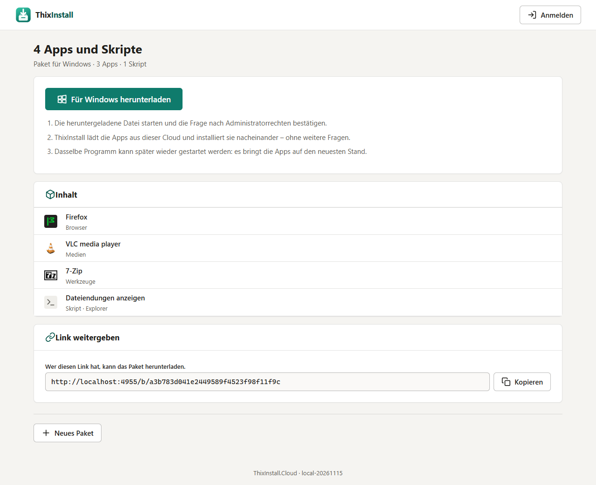 | 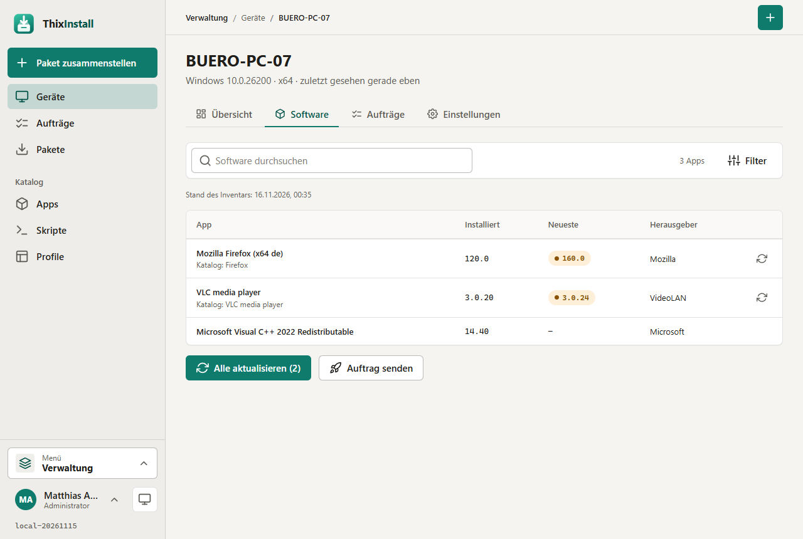 |

| Geräte | Auftrag | Versionen einer App |
|---|---|---|
| 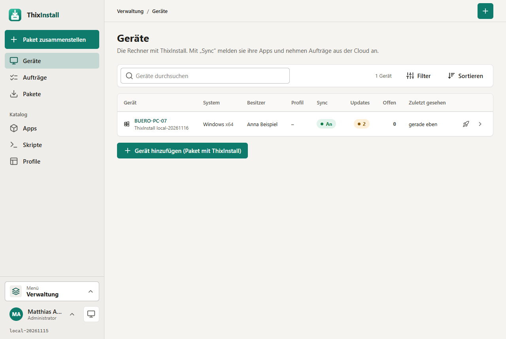 | 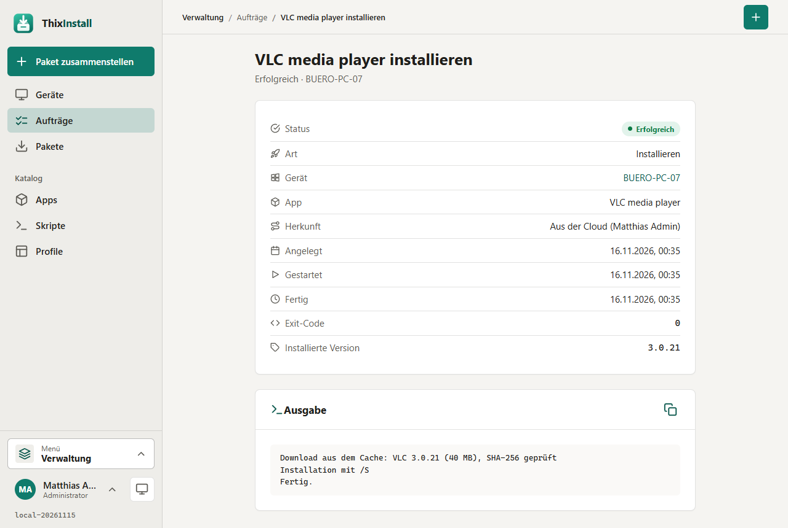 | 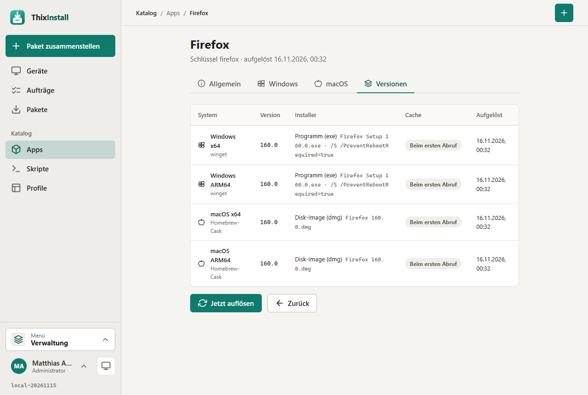 |

| Registrierung eines Profils | Startseite dunkel | Telefon |
|---|---|---|
| 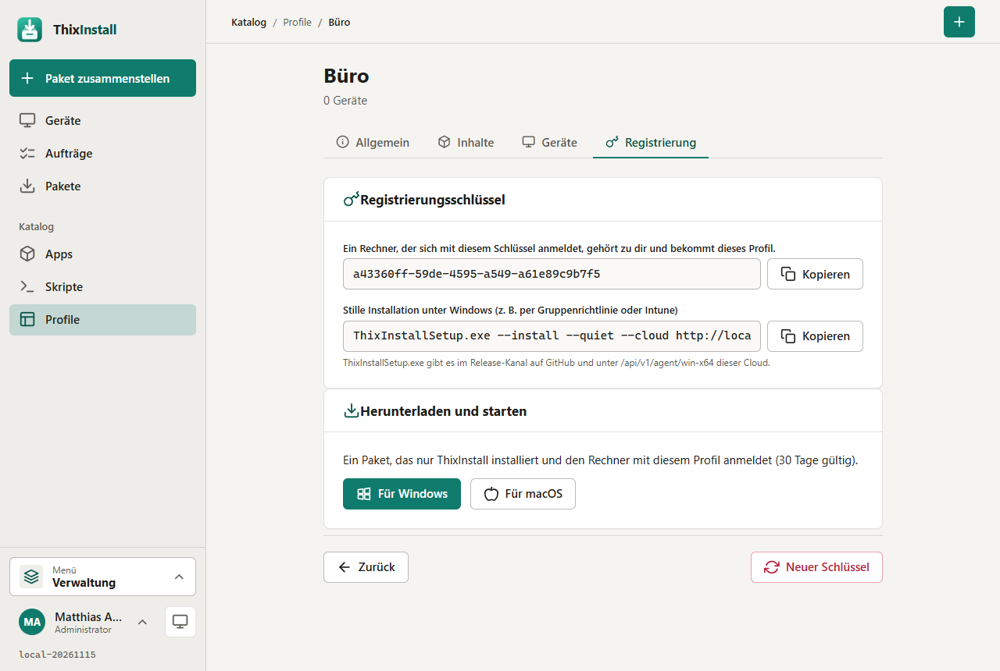 | 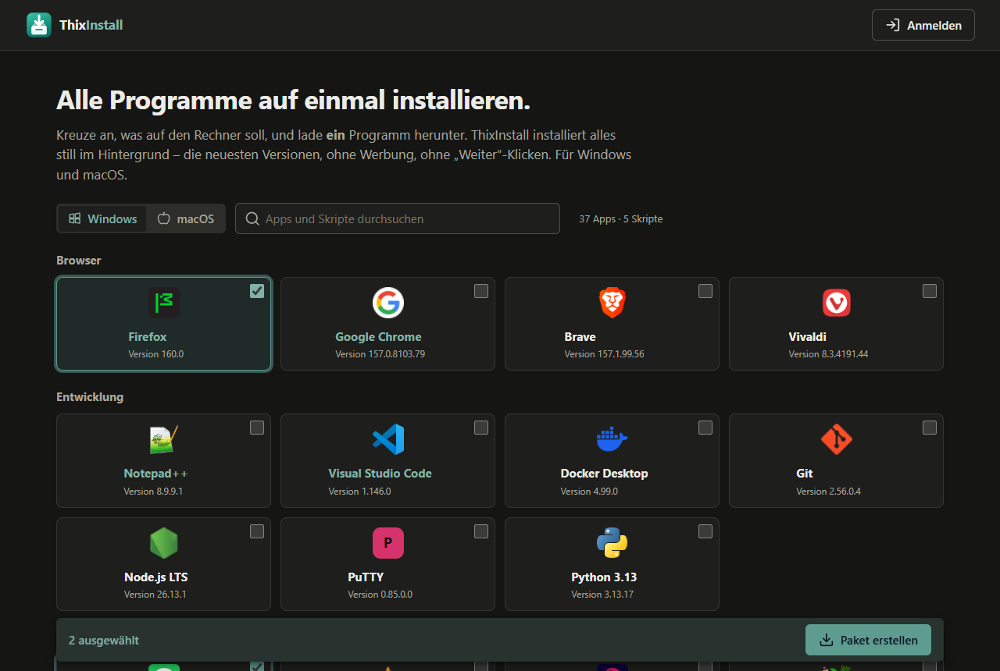 | 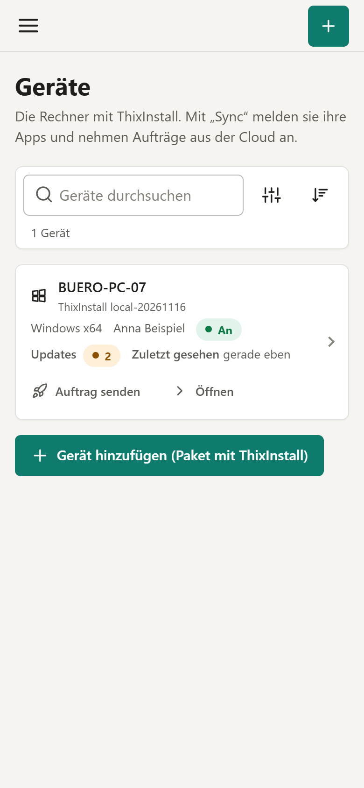 |

| App hinzufügen: Suche über alle Quellen | dunkel | Eigene Datei als Quelle |
|---|---|---|
| 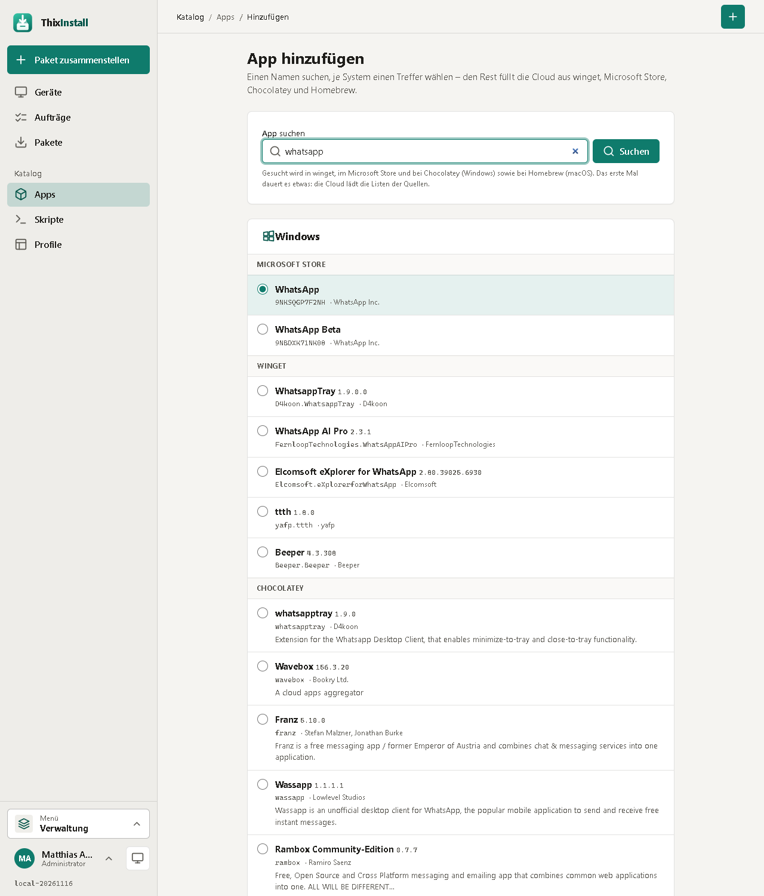 | 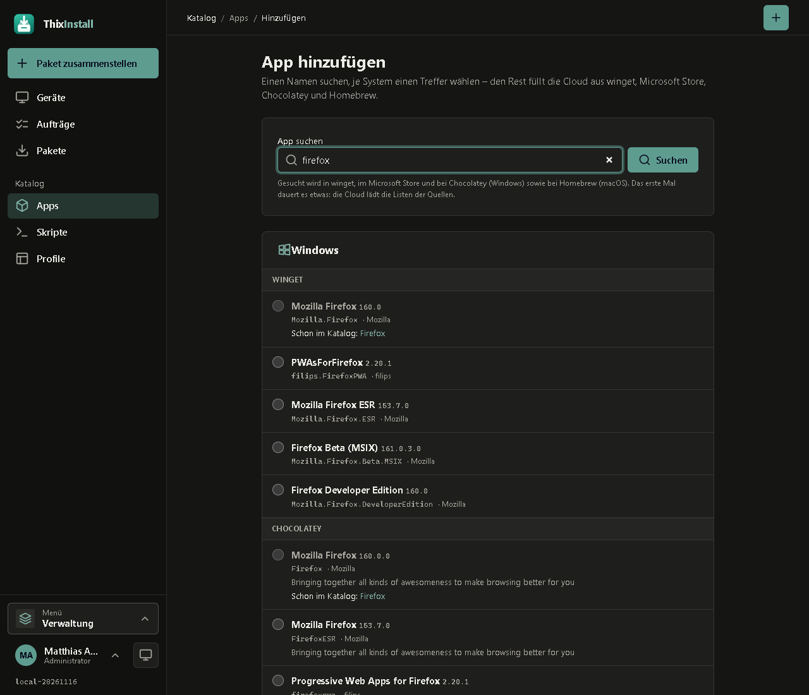 | 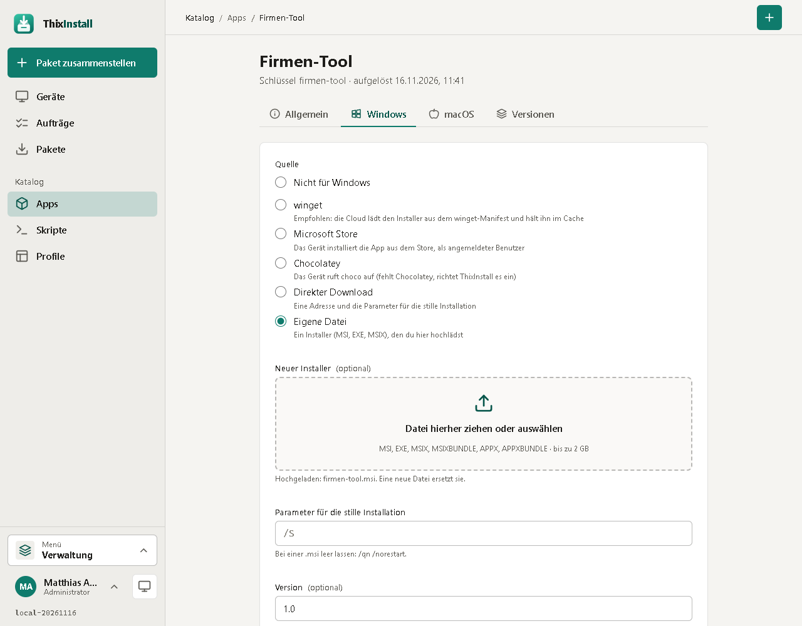 |

## Starten, testen

- Lokal immer den Stack neu bauen: `./scripts/redeploy.ps1` (`-Clean` löscht die Volumes: leere Datenbank, Einrichtungsassistent, Katalog neu
  aufgelöst). App http://localhost:4955, pgAdmin http://localhost:4956, Postgres localhost:4957 (`thixinstall`/`thixinstall`).
- `dotnet test tests/ThixInstall.Cloud.Tests` – Unit-Tests (winget-YAML → Plan, Homebrew-JSON → Plan, Mac-Zip, Ticket, Rechte); mit
  `THIXINSTALL_TEST_DB=Host=localhost;Port=4957;Database=postgres;Username=thixinstall;Password=thixinstall` auch Business-Layer und API gegen
  PostgreSQL (jeder Test bekommt eine eigene Datenbank). Die Tests fragen nie GitHub, Homebrew, Chocolatey oder den Store (`THIXINSTALL_RESOLVE=off`;
  `Net.UseHandlerForTests`: ohne eigene Welt antwortet alles mit 404; Tests mit eigener Welt laufen nacheinander, Collection `world`).
- Browser-Checks: `cd tests/e2e && npm install && node run.js http://localhost:4955` (Playwright mit dem installierten Edge; Einrichtung oder
  Anmeldung, Startseite als Besucher, Paket, Gerät per API, Auftrag aus dem Browser, Verwaltung, dunkel, 390 px). Screenshots in `tests/e2e/shots` – ansehen.
  Testkonten (nur lokal): `admin` / `ThixInstall-Admin-2026`, `anna` / `Anna-Test-2026`.

## Karte

```
Program.cs              Dienste, Cookie-Anmeldung, Rate-Limit, Weiterleitungs-Header, Encoder (Umlaute bleiben Text), Endpunkte
Infrastructure.cs       Healthcheck, Migration + Seed beim Start, Setup-Umleitung, Sicherheits-Header, MaintenanceService (stündlich:
                        Sitzungen, anonyme Pakete > 90 Tage, Cache-Größe), ResolverService (alle 15 min: fällige Pakete auflösen, Icons holen)
Data/                   Entities.cs (alle Tabellen), AppDbContext.cs (PascalCase, Audit-Spalten, Soft-Delete, Sequenz ActionRevision), Migrations/
Business/  (statische Klassen, jede Prüfung mit Actor)
  CatalogService        Apps und Skripte (Admin), Katalog für Geräte/Startseite (anonym: nur öffentliche), Icons
  ReleaseService        löst Quellen je OS/Architektur in PackageRelease auf (winget, Store, Chocolatey mit Version, Direkt, Upload,
                        Cask/Formel); InstallPlan für Geräte
  WingetResolver        winget-pkgs auf GitHub → neueste Version → Installer je Architektur/Scope/Sprache → Art + stille Parameter
  BrewResolver          formulae.brew.sh: Cask (dmg/zip mit einer App, pkg) oder Formel; Intel nimmt die passende "variation"
  DownloadCache         /api/v1/downloads/{id}: einmal laden, SHA-256 prüfen, in /data/cache ablegen, LRU über der eingestellten Größe;
                        hochgeladene Installer kommen aus /data/uploads
  PackageUploads        eigene Installer (Windows msi/exe/msix, macOS dmg/pkg/zip, bis 2 GB): Art an Endung + ersten Bytes, /data/uploads/<sha256>,
                        im Release als "upload:<sha256>"; die Datei geht, wenn keine App sie mehr nutzt
  Sources/              „App hinzufügen“: SourceSearch (alle Quellen parallel, je mit Zeitgrenze; Treffer markieren, was schon im Katalog ist;
                        Vorschlag je System, Kategorie; Anlegen mit Name/Herausgeber/Beschreibung/Homepage/Icon und Auflösen), WingetIndex
                        (source2.msix → SQLite, /data/sources/winget.db), StoreSource (storeedgefd: manifestSearch, packageManifests), ChocolateySource
                        (OData-Feed: Suche, neueste Version), BrewIndex (cask.json/formula.json, kompakt im Speicher), SourceFiles (Listen täglich neu)
  AgentService          Desktop-Pakete: Upload unter /data/agent oder GitHub-Release des Kanals (Manifest 10 min gemerkt, Dateien über den Cache)
  BundleService         Pakete anlegen/lesen/löschen; Download: Windows = Setup + Ticket als Anhang, macOS = Zip der App + .thixinstall-Datei
  DeviceService         Enrollment (Passwort, Profil-Schlüssel, Paket-Token), Token-Prüfung (nur SHA-256 gespeichert), Inventar, Profil, Entfernen
  ActionService         Aufträge: senden (nur mit Sync), Profil anwenden, Long Poll, start/finish/report, abbrechen, Listen
  ProfileService        Profile, Inhalte (neue Inhalte gehen sofort an die Geräte), Schlüssel, Registrierungs-Paket
  UserService, SessionService, AccountService, Passwords, SettingService, SeedData, IconFetcher, Net, Text, Revisions
Api/ApiEndpoints.cs     /api/v1 nach ApiContract (Shared)
Api/BundleDownloadEndpoint.cs   /b/{token}/download?platform=win-x64|osx-arm64|osx-x64
Controls/               ti-field, ti-buttons, ti-table, ti-tabs (je eine Code-Basis)
Pages/                  Index (Startseite, Picker), Bundles/Public (/b/{token}), Devices (Liste, Detail mit Tabs, Push), Actions, Bundles,
                        Catalog/Packages + Catalog/Scripts (Admin), Profiles (Admin), Admin/Users, Admin/Cache, Admin/Settings, Account, About, Error
wwwroot/                matui/ (Kopie), css/app.css (Akzent #0F7B6C, Präfix ti-), js/app.js (Suche der Kacheln), offline.js, pwa.js, sw.js,
                        manifest.webmanifest, offline.html, robots.txt, llms.txt, img/ (Logos aus tools/render-icons.js, app-icons.svg: windows, apple)
```

## Seiten

| Seite | Wer | Inhalt |
|---|---|---|
| `/` | alle | Kacheln je Kategorie (beliebte zuerst), Windows/macOS umschaltbar (Vorgabe aus dem User-Agent), Suche, Skripte; Leiste „n ausgewählt · Paket erstellen“. Angemeldet: Name, „ThixInstall mitinstallieren“, Profil, „Nur ThixInstall herunterladen“. |
| `/b/{token}` | wer den Link hat | Inhalt, Download je Plattform, Anleitung, Link zum Weitergeben |
| `/Devices` | Benutzer: eigene, Admin: alle | Liste mit Sync, Updates, offenen Aufträgen; Detail mit Tabs Übersicht · Software · Aufträge · Einstellungen (Profil, Entfernen); „Auftrag senden“ |
| `/Actions` | wie Geräte | alle Aufträge mit Filter Status/Herkunft; Detail mit Ausgabe, Abbrechen (wartend) |
| `/Bundles` | eigene, Admin alle/anonyme | Pakete mit Downloads; Detail, Löschen |
| `/Catalog/Packages/Add` | Admin | „App hinzufügen“: Name suchen; Treffer je System (Windows: winget, Microsoft Store, Chocolatey; macOS: Cask, Formel) in Gruppen je Quelle, die beste Quelle zuerst, Vorschlag vorgewählt, Vorhandenes verlinkt; Kategorie; „App anlegen“ füllt alles aus den Quellen, holt das Icon und löst auf |
| `/Catalog/Packages` | Admin | Apps; Bearbeiten mit Tabs Allgemein (Icon, sichtbar, beliebt) · Windows (winget/Store/Chocolatey/Direkt/eigene Datei, Weg auf dem Gerät, Erkennung) · macOS (Cask/Formel/Direkt/eigene Datei, Weg) · Versionen („Jetzt auflösen“); „Alle auflösen“ |
| `/Catalog/Scripts` | Admin | Skripte; Tabs Allgemein · Skript (Shell, Kontext System/Benutzer, Text, Zeitgrenze) |
| `/Profiles` | Admin | Tabs Allgemein · Inhalte (Reihenfolge) · Geräte („Auftrag an alle“) · Registrierung (Schlüssel, stille Installation, Download) |
| `/Admin/Users`, `/Admin/Cache`, `/Admin/Settings` | Admin | Benutzer; Cache (Belegung, löschen, leeren); Einstellungen: Allgemein (öffentlicher Katalog, Cache-Größe, Weg zuerst: Cloud-Cache oder Paketmanager) · Desktop-App (Kanal, Uploads) · Quellen (GitHub-Token) |

## API

Siehe `src/ThixInstall.Shared/ApiContract.cs`. Öffentlich: `GET /api/v1/catalog?os=&arch=` (ohne Token nur öffentliche Einträge und nur, wenn die
Startseite öffentlich ist), `GET /api/v1/packages/{id}/icon`, `GET /api/v1/downloads/{releaseId}` (Header `X-Content-SHA256`), `GET /api/v1/bundles/{token}?arch=`,
`POST /api/v1/devices/enroll` (Rate-Limit), `GET /api/v1/agent/manifest`, `GET /api/v1/agent/{platform}`. Mit Geräte-Token: `GET/PUT /api/v1/device`,
`PUT /api/v1/device/inventory` (409 ohne Sync), `GET /api/v1/device/actions/wait`, `GET /api/v1/device/actions` (leer ohne Sync),
`POST …/{id}/start` (409 wenn abgebrochen/gestartet), `POST …/{id}/finish`, `POST /api/v1/device/actions/report`, `POST /api/v1/devices/logout`.

**Das heruntergeladene Paket trägt seine ganze Konfiguration.** `/b/{token}/download` baut das `BundleTicket` mit `Bundle` = genau dem
`BundleDto`, das `GET /api/v1/bundles/{token}?arch=<Architektur der Plattform>` liefern würde (Apps mit Installationsplänen, Skripte mit Inhalt,
`IncludesAgent`, `CanEnroll`, Profilname): Windows hängt es an das Setup an (ein schon vorhandenes Ticket der Datei wird weggelassen), macOS legt es als
`<Name>.thixinstall` neben die App ins Zip (Unix-Rechte der App bleiben erhalten). Die Download-URLs im Plan zeigen weiter auf den Cache dieser Cloud.

## Datenmodell

Wie in ARCHITECTURE.md, mit diesen Einzelheiten: `Package.WindowsMethod` / `MacMethod` (`InstallMethod`, null = nicht für dieses System;
`DirectVersion`/`DirectSilentArguments` gelten auch für den Windows-Upload, `MacDirectVersion` für den macOS-Upload, `StorePackageFamilyName` füllt das Auflösen),
`PackageIcon` (eigene Zeile, Listen laden keine Bytes), `PackageRelease.Note` (Hinweis wie „Wird mit brew installiert.“, kein Fehler) neben
`Error` (letzte Auflösung fehlgeschlagen, alter Stand bleibt), `Device.TokenHash` (SHA-256 des Tokens), `DeviceAction.Revision` aus der Sequenz
`ActionRevision` (Long Poll je Gerät, Advisory-Lock je Gerät), `Bundle.Token` (uuid, in Links als 32 Hex-Zeichen), `Setting` (PublicCatalog,
CacheMaxGigabytes, DesktopChannel, GitHubToken, Seeded).

## Auflösen und Cache

- Jedes Paket wird beim Speichern und danach alle 6 h aufgelöst (`ResolverService`, „Jetzt auflösen“, „Alle auflösen“). winget kostet eine
  GitHub-API-Anfrage pro Paket (ohne Token 60 pro Stunde: für große Kataloge unter Einstellungen › Quellen ein Token hinterlegen).
- winget-Typen: msi/wix → MSI `/qn /norestart`, nullsoft `/S`, inno `/VERYSILENT /SUPPRESSMSGBOXES /NORESTART /SP-` (+ `/ALLUSERS` bei Scope machine),
  burn `/quiet /norestart`, exe nur mit `InstallerSwitches.Silent`, msix/appx → MSIX; `Silent` ersetzt, `Custom` ergänzt. zip/portable/exe ohne Schalter:
  Plan ohne Download → das Gerät ruft `winget install` auf.
- Casks: genau eine App in dmg/zip oder ein reines pkg → Download über den Cache; Links ins Terminal (`binary`) stören nicht; Installer-Skripte,
  Suites und Adressen ohne Dateiendung → `brew install --cask`. `sha256: no_check` → keine Prüfung, die Cloud merkt sich, was sie geladen hat.
- Microsoft Store: `packageManifests/{id}` → Version (bei „Unknown“ keine: die App aktualisiert sich selbst) und Paketfamilie (Erkennung von
  MSIX-Apps); kein Download, das Gerät ruft `winget install --id <id> --source msstore` als angemeldeter Benutzer auf.
- Chocolatey: die neueste Version aus `Packages()?$filter=Id eq '<id>' and IsLatestVersion` (Update-Anzeige); ist Chocolatey nicht erreichbar,
  bleibt der Plan ohne Version. Der Titel wird zum Erkennungsnamen, wenn keiner gesetzt ist und er vom Namen abweicht.
- Direkt (macOS) und eigene Datei: die Art kommt aus der Endung (.dmg, .pkg, .zip); bei dmg und zip ist der Name der App nötig. Eine Datei
  gilt für beide Architekturen.
- Suche („App hinzufügen“): der winget-Index (`cdn.winget.microsoft.com/cache/source2.msix`, ~4 MB) und die Homebrew-Listen (~50 MB) liegen in
  `/data/sources` und werden höchstens täglich neu geladen (beim Öffnen der Seite angestoßen; die alte Liste dient, bis die neue da ist); Store
  und Chocolatey werden live gefragt. Antworten bleiben 5 Minuten gemerkt.
- Der Cache prüft die SHA-256 des Releases; passt sie nicht, wird die Datei verworfen. Ein Schloss pro Adresse verhindert doppelte Downloads.
- Der `InstallPlan` trägt Cache und Paketmanager (`WingetId`, `ChocoId`) und den Weg, den das Gerät zuerst nimmt (`Route`): die Wahl der App
  (`Package.WindowsRoute`/`MacRoute`, leer = Einstellung) oder die Einstellung `InstallRoute` (Standard: Cloud-Cache zuerst). Bei winget als
  Quelle ist die Chocolatey-Id der Ausweichweg (optional, geprüft); bei Chocolatey als Quelle die winget-Id, soweit bekannt.
- Icons: einmal pro Paket `apple-touch-icon.png`, dann `favicon.ico` der Homepage (nur echte Bilder, erkannt an den ersten Bytes); hochgeladene
  SVGs ohne `<script>` und mit eigener CSP ausgeliefert.

## Bekannte Grenzen

- Chocolatey, Homebrew-Formeln und der Microsoft Store laufen immer über die Kommandozeile des Geräts (kein Cache).
- Beim ersten Abruf einer Datei lädt die Cloud sie ganz von der Quelle, bevor das Gerät das erste Byte bekommt (mit „winget/Chocolatey/Homebrew
  zuerst“ lädt das Gerät selbst beim Hersteller).
- Eigene Dateien bis 2 GB (nur auf der Bearbeiten-Seite; sonst gilt die Grenze von 402 MB). Ein Reverse-Proxy davor braucht dieselbe Grenze.
- Ohne veröffentlichten Desktop-Build (GitHub-Release des Kanals) oder Upload unter Einstellungen › Desktop-App gibt es keinen Paket-Download;
  die Paketseite sagt das.
